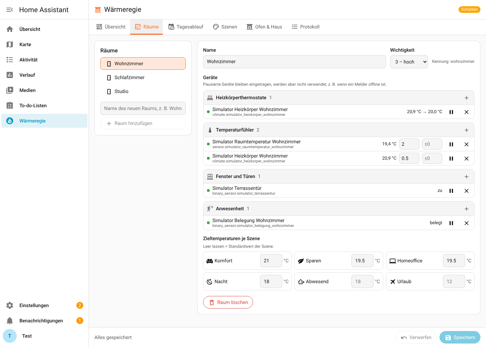
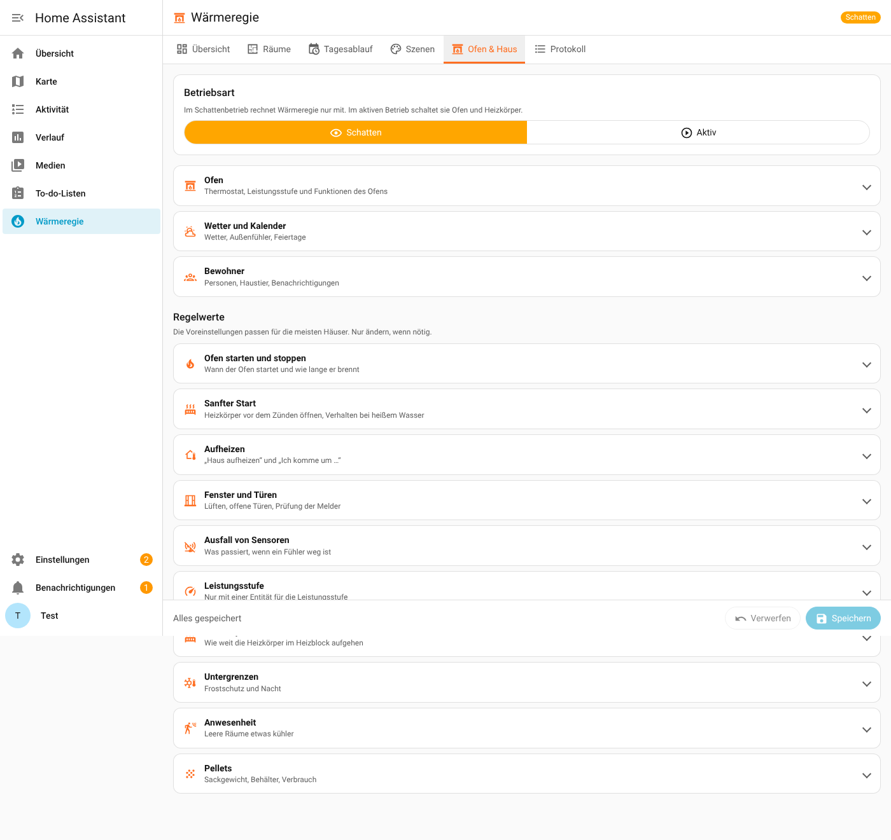
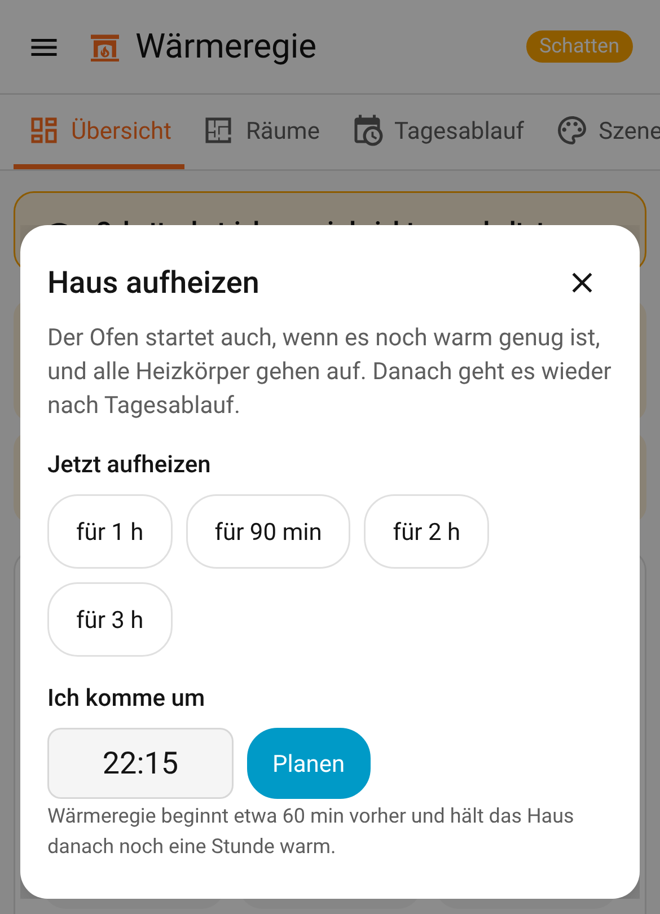
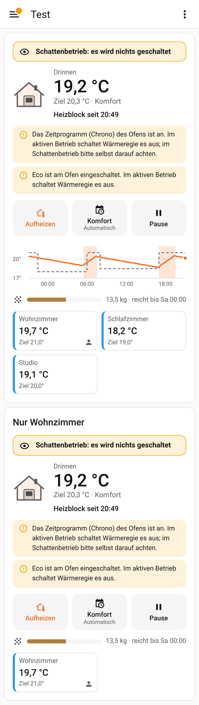

# Handbuch: Wärmeregie

> ⚠️ **Version 0.5.** Die Wärmeregie startet im **Schattenbetrieb**: Sie rechnet und schreibt ins Protokoll, was sie tun würde, schaltet aber nichts. Noch nicht mit echter Hardware getestet. Alle Bilder stammen aus einer simulierten Test-Instanz mit erfundenen Werten.

## Wofür
Ein Pelletofen ohne Pufferspeicher taktet leicht: Sind die Heizkörperventile zu, wird das Wasser schnell heiß, der Ofen geht aus und bald wieder an. Die Wärmeregie steuert Ofen und Heizkörper gemeinsam, damit der Ofen **seltener, aber länger** brennt und die Wärme auch wirklich in die Räume kommt.

## Einrichten
1. *Einstellungen → Geräte & Dienste → Integration hinzufügen → Wärmeregie*. Optional gleich das Thermostat des Ofens wählen.
2. In der Seitenleiste erscheint **Wärmeregie**. Dort alles Weitere:
   - **Ofen & Haus:** Ofen-Thermostat und, falls vorhanden, die Ofen-Funktionen: Leistungsstufe, Chrono (Zeitprogramm), Eco, Störungsmelder, Wassertemperatur, Zündzähler. Außerdem Wetter oder Außenfühler, Arbeitstag-Sensor (für Feiertage), Personen, Haustier, Benachrichtigungen (z. B. dein Handy), Regel-Parameter.
   - **Räume:** je Raum Heizkörper, Temperaturfühler (mehrere möglich, mit Gewicht), Fenster/Türen, Bewegungs- oder Anwesenheitsmelder, Wichtigkeit (1–3) und Zieltemperaturen je Szene.
   - **Szenen:** z. B. Komfort, Sparen, Homeoffice, Nacht, Abwesend, Urlaub. Je Szene ein Standardziel und was der Ofen darf (heizen / nur Frostschutz / aus).
   - **Tagesablauf:** Tagesarten (Bürotag, Homeoffice, Wochenende) mit Uhrzeiten, ab wann welche Szene gilt, und welche Tagesart an welchem Wochentag und an Feiertagen gilt.
3. **Speichern.** Fehler (z. B. eine Uhrzeit doppelt) zeigt das Panel direkt an.

**Geräte pausieren:** Auf der Raum-Seite hat jedes Gerät einen Pausieren-Knopf. Ein pausiertes Gerät bleibt eingetragen, wird aber nicht verwendet (grauer Punkt). Ein oranger Punkt heißt „nicht verfügbar“; mit *Nicht verfügbare pausieren* sind alle auf einmal still, bis sie wieder gehen.

**Tipp zu Fühlern:** Heizkörperthermostate messen am Heizkörper und zeigen oft zu warm, besonders während geheizt wird. Ein eigener Raumfühler bekommt deshalb ein höheres Gewicht (z. B. 2), das Thermostat ein niedriges (z. B. 0,5).

**Korrektur:** Misst ein Fühler immer etwas daneben, trägst du neben dem Gewicht eine *Korrektur* ein (−5 bis +5 °C). −1 heißt: Der Fühler zeigt 1 °C zu viel. Am besten alle Fühler einen Tag nebeneinander laufen lassen und mit einem guten Thermometer vergleichen. Gute Raumfühler: 1,2 bis 1,5 m hoch an einer Innenwand, nicht über dem Heizkörper, nicht in der Sonne, weit weg vom Ofen.

## Was die Wärmeregie tut
- **Heizblock starten**, wenn die Räume (gewichtet nach Wichtigkeit) mindestens 0,5 K unter Ziel sind.
- **Mindestens 90 Minuten brennen**, dann aus, sobald das Ziel um 0,3 K überschritten ist (höchstens 5 Stunden).
- **Mindestens 60 Minuten Pause** nach jedem Block, **höchstens 4 Starts** pro Tag. Frostschutz geht immer.
- **Sanfter Start:** Vor dem Zünden gehen zuerst die Heizkörper auf, 5 Minuten später zündet der Ofen (Phase *Heizkörper öffnen*). Ohne Pufferspeicher wird das Wasser sonst so schnell heiß, dass der Ofen gleich wieder selbst abschaltet.
- **Während eines Blocks** werden die Heizkörper 1 K über Ziel gestellt, damit sie öffnen und die Wärme abnehmen.
- **Ofen schaltet selbst ab:** Wird das Wasser trotzdem zu heiß (ab 50 °C), schaltet der Ofen selbst ab und zündet nach dem Abkühlen wieder. Die Wärmeregie wartet darauf bis zu 30 Minuten, statt den Block zu beenden, und zählt das nicht als neuen Start.
- **Fenster/Tür offen:** bis 2 Minuten nichts; danach Heizkörper des Raums auf Frostschutz; ab 10 Minuten kein neuer Ofenstart und eine Nachricht. Ist im Raum laut Meldern niemand, kommt die Nachricht schon nach 1 Minute (z. B. wenn der Hund die Tür aufstößt).
- **Nach dem Lüften:** Ist das Fenster wieder zu, zählt der Raum noch 20 Minuten nicht für den Ofenstart (Parameter *Nach dem Lüften warten*). So springt der Ofen nicht an, nur weil die Luft am Fenster kurz kalt ist. War es nur kurz offen (unter 2 Minuten), gilt das nicht.
- **Sensor kurz weg:** Ist ein Fühler, Fenster oder Melder kurz nicht erreichbar (bei Zigbee häufig ein, zwei Minuten), gilt bis zu 30 Minuten sein letzter Wert. Ein offenes Fenster bleibt offen. Danach zählt ein Fenster als zu und ein Fühler wird weggelassen.
- **Sensor lange weg:** Nach 60 Minuten kommt eine Nachricht, höchstens einmal am Tag je Sensor. In der Raum-Seite steht unter jedem Gerät, wie oft es in den letzten 24 Stunden weg war. Ein unzuverlässiges Gerät lässt sich dort pausieren.
- **Fenster meldet offen, Raum kühlt nicht ab:** Nach 60 Minuten kommt einmal die Nachricht „Sensor prüfen?“. Der Raum bleibt trotzdem auf Frostschutz, bis das Fenster „zu“ meldet oder du den Sensor pausierst. Absichtlich: Ein falsches „offen“ macht es nur kühler, ein falsches „zu“ würde bei offenem Fenster heizen.
- **Lüften nach dem Duschen:** Hat ein Raum einen Feuchtefühler (Raum-Seite, Gruppe *Luftfeuchte*, auch der Fühler eines Heizkörperthermostats geht), gilt ein offenes Fenster bei hoher Feuchte als gewolltes Lüften. Hoch heißt: über 65 % ODER mindestens 6 Prozentpunkte über dem Tiefstwert der letzten 90 Minuten. Der zweite Wert ist wichtig, weil ein Fühler weit weg von der Dusche oft nur von 40 auf 50 % steigt. Die Heizkörper gehen trotzdem auf Frostschutz, nur die Nachricht „Fenster offen“ wartet, bis die Feuchte wieder fast beim Grundwert ist (2 Punkte darüber). Ab da zählt die normale Wartezeit. Steht das Fenster länger als 30 Minuten feucht offen, kommt die Nachricht trotzdem.
- **Leere Räume** (laut Meldern seit 45 Minuten niemand) werden 1,5 K kühler gehalten.
- **Leistungsstufe:** knapp über der Startschwelle kleinste Stufe (Standard 1), ab 2 K Bedarf oder unter 0 °C außen höchste (Standard 3). Bei lange offener Tür kleinste Stufe.
- **Störung:** Meldet der Ofen eine Störung, startet kein Block, und ein laufender endet.

## Heizkörper als Puffer und Lernen
Ein Pelletofen **ohne Pufferspeicher** kann seine Wärme nur über die Heizkörper loswerden. Sind sie zu (Räume schon warm), steigt das Kesselwasser weiter, auch noch nach dem Abschalten (Nachwärme), und der Ofen kocht hoch. Darum gilt ohne Puffer (*Ofen & Haus → Heizkörper als Puffer*, „Pufferspeicher vorhanden“ aus):

- **Unscharf statt Schalter:** Statt bei 70 °C schlagartig alles aufzudrehen, öffnet die Wärmeregie die Heizkörper umso weiter, je heißer der Kessel ist. Ab 65 °C ein wenig, ab 80 °C ganz (Standard: Mitte 70 °C, Rampe −5/+10 K). „Ganz“ heißt: Heizkörper 2 K über Ziel, oder über der Raumtemperatur, wenn der Raum schon wärmer ist, damit das Thermostat wirklich öffnet.
- **Warme Räume** bekommen etwas weniger, aber nie weniger als die Hälfte. Nahe am Kesselschutz (ab 85 °C) bekommen alle den vollen Wert: Sicherheit vor Komfort.
- **Ende:** Unter 60 °C gelten wieder die normalen Sollwerte. Fenster offen heißt weiter Frostschutz.
- **Kesselschutz** bleibt hart: ab 90 °C Ofen aus und alle Heizkörper auf 26 °C, bis unter 75 °C.
- **Lernen** (abschaltbar): Die Wärmeregie misst, bei welcher Wassertemperatur der Ofen selbst abschaltet und wie viel das Wasser danach noch steigt. Daraus rechnet sie, wann sie spätestens öffnen muss, damit die Spitze unter dem Kesselschutz bleibt. Das kann die Mitte nur **früher** machen, nie später als eingestellt, und erst nach 3 Messungen. Unter *Gelernt* stehen die Werte; *Gelerntes zurücksetzen* vergisst sie.

## Meldungen aufs Handy
Unter *Ofen & Haus → Meldungen* stellst du ein, was kommt:
- **Arten einzeln ein/aus:** Fenster länger offen, Fenster offen ohne Abkühlen, Geräte nicht erreichbar, Pellets, Ofen-Störung.
- **Fenster erst melden nach** 10 Minuten (die Heizung reagiert trotzdem sofort; auch im leeren Raum wartet die Nachricht so lange).
- **Gleiche Meldung frühestens wieder nach** 60 Minuten: Ein Fenster, das auf und zu geht, meldet nicht jedes Mal.
- **Ruhezeit** 22:00 bis 07:00: In dieser Zeit kommt nur die Ofen-Störung. Was sonst angefallen wäre, kommt am Morgen in einer Nachricht; ein Fenster, das inzwischen wieder zu ist, fällt weg. Beide Felder leer = keine Ruhezeit.
- **Lüften wegen Feuchte höchstens** 30 Minuten (siehe oben).

Die Hinweise in der Übersicht bleiben davon unberührt.

Alle Zeiten und Schwellen lassen sich unter *Ofen & Haus* ändern, aber nur innerhalb fester Grenzen (z. B. nie weniger als 30 Minuten Pause).

## Bedienen

Oben steht die mittlere Temperatur im Haus mit dem Ziel und dem Verlauf der letzten 24 Stunden (Linie = drinnen, gestrichelt = Ziel, Flächen = Ofen brennt). Darunter Pellets, Ofen und Räume. Selten Gebrauchtes (Starts heute, Wasser, Zündungen, Tagesablauf) steht beim Ofen unter *Details*.

- **Aufheizen:** Der Ofen startet einen ganzen Heizblock, auch wenn es gerade warm genug ist oder „Abwesend“ gilt, und alle Heizkörper gehen auf. Wähle *für 1 h / 90 min / 2 h / 3 h* oder **„Ich komme um …“**: Dann beginnt die Wärmeregie rechtzeitig vorher (Standard 60 Minuten) und hält das Haus nach der Ankunft noch eine Stunde warm. Es gelten die Ziele der Aufheiz-Szene (Standard: Komfort) plus 1 °C. Mindestpause, Starts pro Tag, offene Türen und Störungen gelten weiter. Abbrechen mit dem × neben „Aufheizen bis …“.
- **Szene:** Knopf in der Mitte, die Auswahl öffnet sich. Im Panel und in der Karte gilt sie 3 Stunden, über die Entität *Szene* bis zum nächsten Wechsel im Zeitplan. Danach wieder automatisch. Dort auch *+1 °C für 1 Stunde* und *Alles von Hand aufheben*.
- **Pause:** Ofen 1, 2 oder 4 Stunden nicht starten.
- **Pellets:** Füllstand als Grafik, *Sack nachgefüllt* direkt darunter.
- Für Automationen und Sprachassistenten gibt es Entitäten (*Phase*, *Aktive Szene*, *Tagesart*, *Starts heute*, *Wärmebedarf*, *Heizblock*, *Öffnung offen*, *Szene*, *Steuerung aktiv*, Knopf *Haus aufheizen*) und Dienste (`waermeregie.set_scene`, `clear_scene`, `pause_stove`, `boost`, `warmup`, `cancel_warmup`).
- **Beispiel Heimweg:** Automation „Wenn mein Handy die Zone *Büro* verlässt → Dienst `waermeregie.warmup` mit `minutes: 90`“, oder per Siri den Knopf *Haus aufheizen* drücken.
- **Dashboard-Karte:** im Dashboard *Karte hinzufügen → Wärmeregie* (oder im YAML `type: custom:waermeregie-card`, optional `rooms: [wohnzimmer]`, `title`, `show_actions: false`, `chart: false`, `show_pellets: false`, `show_rooms: false`).

Auf dem Handy:

## KI-Berater (freiwillig)
Hast du in Home Assistant eine KI eingerichtet (z. B. OpenAI), kannst du sie unter *Ofen & Haus → Umgebung → KI-Berater* eintragen. Im Reiter *Regeln* gibt es dann den Knopf **KI um Vorschläge fragen**.

- Die KI bekommt deine verstellbaren Werte mit Grenzen, den Zeitplan, die Regeln und deine Rückmeldungen der letzten vier Wochen. Räume heißen dabei „Raum A“, „Raum B“; Personen, Geräte und Adressen gehen nicht mit. Mit **Zeigen, was geschickt wird** siehst du das Paket vorher.
- Sie darf Werte ändern und neue Regeln vorschlagen. Jeder Vorschlag erscheint als Karte: Annehmen, Anpassen oder Nein danke. Von selbst ändert sich nichts.
- Schutzregeln (Kesselschutz, Frostschutz, Pause gegen Takten, Starts pro Tag) kann die KI nicht anfassen. Was außerhalb der Grenzen liegt, wird verworfen.
- Neue Regeln der KI laufen nach dem Annehmen zuerst einen Tag im Probelauf.
- Für Automationen gibt es den Dienst `waermeregie.ai_suggest`. Auch er legt nur Vorschläge an.

## Rückmeldung am Tablet und per Sprache
- **Tablet:** Füge im Dashboard die Karte *Wärmeregie Rückmeldung* hinzu und trage den Raum ein. Beispiel: `type: custom:waermeregie-feedback-card`, `room: Bad`, `source: Tablet Bad`.
- **Sprache:** Mit einem KI-Sprachassistenten (z. B. OpenAI, Zugriff „Assist“ eingeschaltet) reicht „Mir ist kalt“ oder „Im Schlafzimmer ist es zu warm“. Ohne Raum zählt es fürs ganze Haus; „Mir ist kalt“ heizt dann an wie der Knopf.

## Pelletvorrat
Die Wärmeregie zählt mit, wie lange der Ofen brennt, und schätzt daraus, wie viel noch im Behälter ist und wann er leer sein wird. Die Messung läuft auch im Schattenbetrieb.

- **Nach dem Nachfüllen** den Knopf **„Sack Pellets nachgefüllt“** drücken (zählt einen Sack laut Einstellung dazu, höchstens bis der Behälter voll ist). Andere Mengen: Dienst `waermeregie.pellets_refill` mit `kg`.
- **Ist der Behälter leer**, den Knopf **„Pelletbehälter war leer“** drücken. Daraus lernt die Wärmeregie den echten Verbrauch pro Brennstunde (eingefüllte kg seit dem letzten „leer“ geteilt durch die Brennstunden). Meldet der Ofen eine Störung, während die Schätzung fast bei null ist, wird das automatisch als „leer“ gewertet.
- **Erstmals einrichten:** Dienst `waermeregie.pellets_set` mit dem aktuellen Vorrat in kg; `from_empty: true`, wenn der Behälter davor leer war (dann wird ab dieser Füllung gelernt).
- **Erinnerung:** Unterschreitet die Schätzung die Schwelle (Standard 5 kg), kommt einmal pro Füllung eine Nachricht.
- Einstellungen unter *Ofen & Haus → Pellets*: Sackgewicht, Fassungsvermögen, Startwert für den Verbrauch, Erinnerungsschwelle.

Die Schätzung ist anfangs grob (Startwert 1,5 kg/h) und wird mit jedem leeren Behälter genauer.

## Schattenbetrieb und aktiver Betrieb
- **Schattenbetrieb** (ab Werk): nichts wird geschaltet. Im **Protokoll** steht, was die Wärmeregie getan hätte (orange markiert). Empfehlung: 2–3 Wochen beobachten.

- **Aktiver Betrieb:** im Panel unter *Ofen & Haus* ganz oben umschalten (mit Bestätigung) oder Schalter *Steuerung aktiv*. Dann übernimmt die Wärmeregie die Steuerung: Ofen ein/aus mit Block-Sollwert, Leistungsstufe, Heizkörper-Sollwerte, und sie schaltet Chrono und Eco des Ofens aus, damit nur eine Stelle steuert.
- Sind Chrono oder Eco des Ofens **nicht** zugeordnet, bitte am Ofen selbst ausschalten. Sind sie zugeordnet, zeigt das Panel im Schattenbetrieb einen Hinweis, wenn sie an sind.
- Schaltet jemand den Ofen von Hand ein, übernimmt die Wärmeregie das als Heizblock. Geht er aus (von Hand, oder von selbst bei kaltem Wasser), merkt sie das und hält die Pause ein.

## Wenn etwas nicht geht
- **„… hat keine eindeutige ID“:** Die Entität stammt aus YAML ohne `unique_id` und kann nicht verwendet werden.
- **Räume zeigen „Fühler fehlen“:** ein Temperaturfühler ist nicht verfügbar; die Wärmeregie rechnet mit den übrigen.
- **„Ofen nicht erreichbar“:** Die Ofen-Entität ist nicht verfügbar; im aktiven Betrieb startet dann kein Block.
