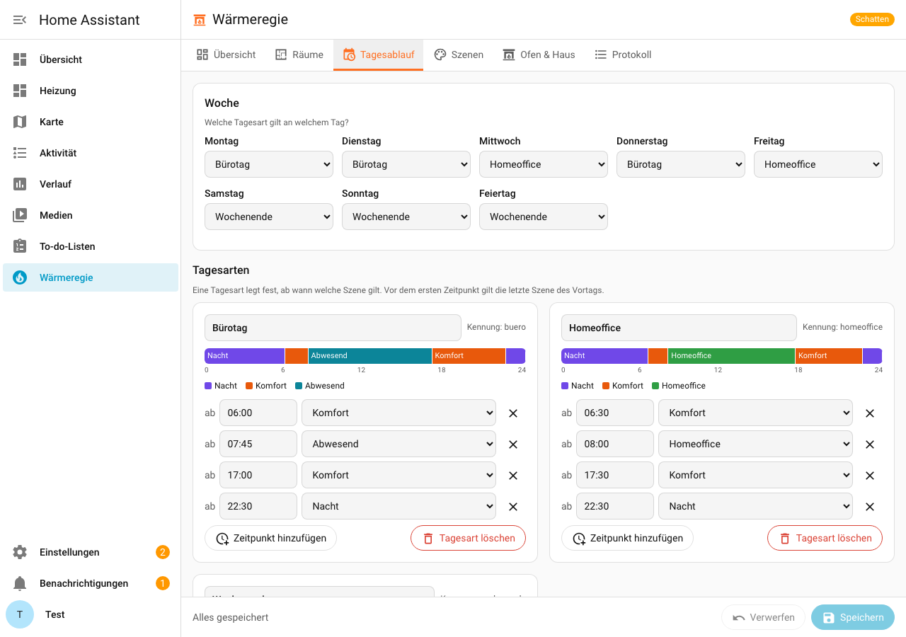
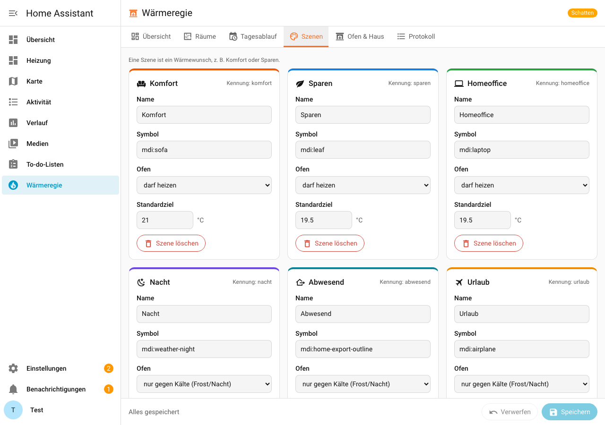
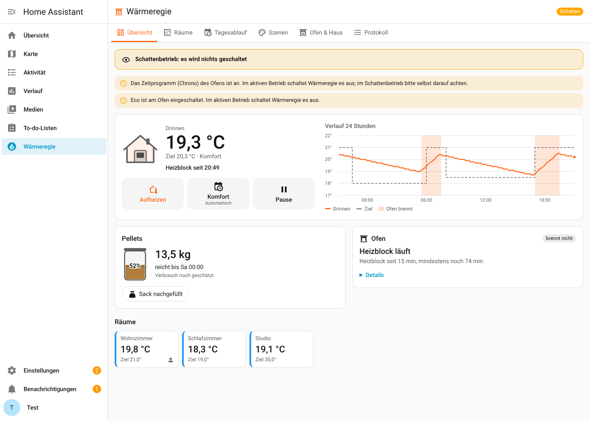
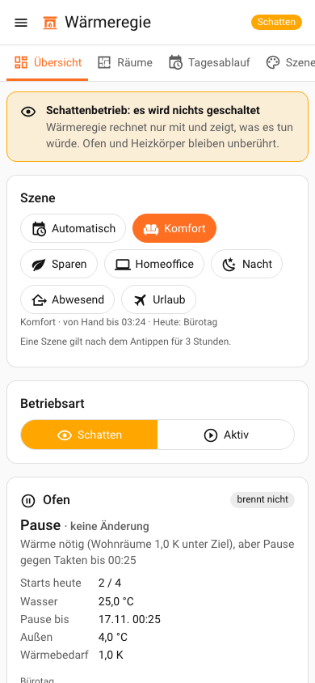
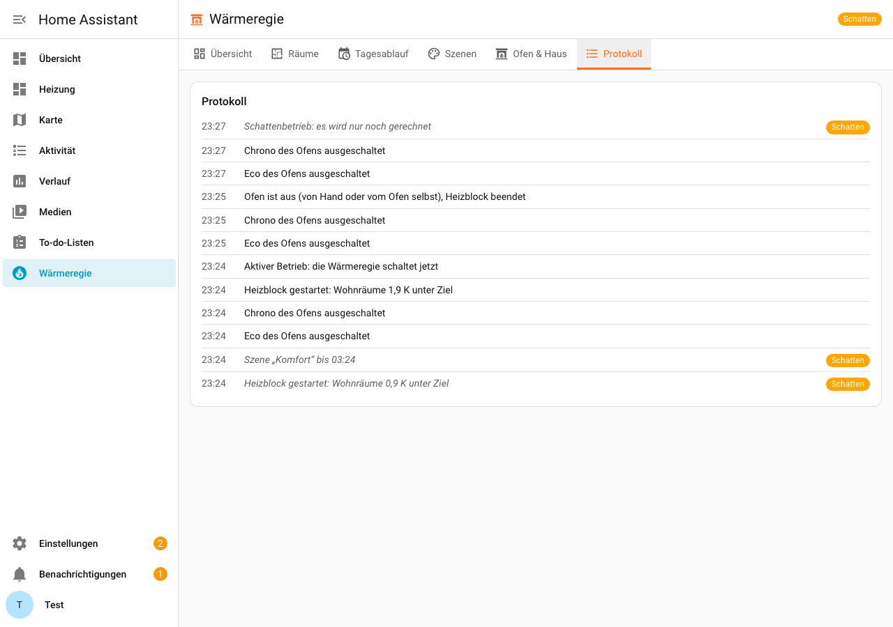

# Handbuch: Wärmeregie

> ⚠️ **Version 0.1.** Die Wärmeregie startet im **Schattenbetrieb**: Sie rechnet und schreibt ins Protokoll, was sie tun würde, schaltet aber nichts. Noch nicht mit echter Hardware getestet. Alle Bilder stammen aus einer simulierten Test-Instanz mit erfundenen Werten.

## Wofür
Ein Pelletofen ohne Pufferspeicher taktet leicht: Sind die Heizkörperventile zu, wird das Wasser schnell heiß, der Ofen geht aus und bald wieder an. Die Wärmeregie steuert Ofen und Heizkörper gemeinsam, damit der Ofen **seltener, aber länger** brennt und die Wärme auch wirklich in die Räume kommt.

## Einrichten
1. *Einstellungen → Geräte & Dienste → Integration hinzufügen → Wärmeregie*. Optional gleich das Thermostat des Ofens wählen.
2. In der Seitenleiste erscheint **Wärmeregie**. Dort alles Weitere:
   - **Ofen & Haus:** Ofen-Thermostat und, falls vorhanden, die Ofen-Funktionen: Leistungsstufe, Chrono (Zeitprogramm), Eco, Störungsmelder, Wassertemperatur, Zündzähler. Außerdem Wetter oder Außenfühler, Arbeitstag-Sensor (für Feiertage), Personen, Haustier, Benachrichtigungen (z. B. dein Handy), Regel-Parameter.
   - **Räume:** je Raum Heizkörper, Temperaturfühler (mehrere möglich, mit Gewicht), Fenster/Türen, Bewegungs- oder Anwesenheitsmelder, Wichtigkeit (1–3) und Zieltemperaturen je Szene.
   - **Szenen:** z. B. Komfort, Sparen, Homeoffice, Nacht, Abwesend, Urlaub. Je Szene ein Standardziel und was der Ofen darf (heizen / nur Frostschutz / aus).
   - **Tagesablauf:** Tagesarten (Bürotag, Homeoffice, Wochenende) mit Uhrzeiten, ab wann welche Szene gilt, und welche Tagesart an welchem Wochentag und an Feiertagen gilt.
3. **Speichern.** Fehler (z. B. eine Uhrzeit doppelt) zeigt das Panel direkt an.

**Geräte pausieren:** Auf der Raum-Seite hat jedes Gerät einen Pausieren-Knopf. Ein pausiertes Gerät bleibt eingetragen, wird aber nicht verwendet (grauer Punkt). Ein oranger Punkt heißt „nicht verfügbar“; mit *Nicht verfügbare pausieren* sind alle auf einmal still, bis sie wieder gehen.

**Tipp zu Fühlern:** Heizkörperthermostate messen am Heizkörper und zeigen oft zu warm. Ein eigener Raumfühler bekommt deshalb ein höheres Gewicht (z. B. 2), das Thermostat ein niedriges (z. B. 0,5).

## Was die Wärmeregie tut
- **Heizblock starten**, wenn die Räume (gewichtet nach Wichtigkeit) mindestens 0,5 K unter Ziel sind.
- **Mindestens 90 Minuten brennen**, dann aus, sobald das Ziel um 0,3 K überschritten ist (höchstens 5 Stunden).
- **Mindestens 60 Minuten Pause** nach jedem Block, **höchstens 4 Starts** pro Tag. Frostschutz geht immer.
- **Während eines Blocks** werden die Heizkörper 1 K über Ziel gestellt, damit sie öffnen und die Wärme abnehmen.
- **Fenster/Tür offen:** bis 2 Minuten nichts; danach Heizkörper des Raums auf Frostschutz; ab 10 Minuten kein neuer Ofenstart und eine Nachricht. Ist im Raum laut Meldern niemand, kommt die Nachricht schon nach 1 Minute (z. B. wenn der Hund die Tür aufstößt).
- **Nach dem Lüften:** Ist das Fenster wieder zu, zählt der Raum noch 20 Minuten nicht für den Ofenstart (Parameter *Nach dem Lüften warten*). So springt der Ofen nicht an, nur weil die Luft am Fenster kurz kalt ist. War es nur kurz offen (unter 2 Minuten), gilt das nicht.
- **Leere Räume** (laut Meldern seit 45 Minuten niemand) werden 1,5 K kühler gehalten.
- **Leistungsstufe:** knapp über der Startschwelle kleinste Stufe (Standard 1), ab 2 K Bedarf oder unter 0 °C außen höchste (Standard 3). Bei lange offener Tür kleinste Stufe.
- **Störung:** Meldet der Ofen eine Störung, startet kein Block, und ein laufender endet.

Alle Zeiten und Schwellen lassen sich unter *Ofen & Haus* ändern, aber nur innerhalb fester Grenzen (z. B. nie weniger als 30 Minuten Pause).

## Bedienen

- **Szene von Hand:** in der Übersicht antippen. Im Panel und in der Karte gilt sie 3 Stunden, über die Entität *Szene* bis zum nächsten Wechsel im Zeitplan. Danach wieder automatisch.
- **+1 °C für 1 Stunde**, **Ofen 2 Stunden pausieren**, **Aufheben**.
- Für Automationen und Sprachassistenten gibt es Entitäten (*Phase*, *Aktive Szene*, *Tagesart*, *Starts heute*, *Wärmebedarf*, *Heizblock*, *Öffnung offen*, *Szene*, *Steuerung aktiv*) und Dienste (`waermeregie.set_scene`, `clear_scene`, `pause_stove`, `boost`).
- **Dashboard-Karte:** im Dashboard *Karte hinzufügen → Wärmeregie* (oder im YAML `type: custom:waermeregie-card`, optional `rooms: [wohnzimmer]`, `title`, `show_actions: false`).

Auf dem Handy:

## Pelletvorrat
Die Wärmeregie zählt mit, wie lange der Ofen brennt, und schätzt daraus, wie viel noch im Behälter ist und wann er leer sein wird. Die Messung läuft auch im Schattenbetrieb.

- **Nach dem Nachfüllen** den Knopf **„Sack Pellets nachgefüllt“** drücken (zählt einen Sack laut Einstellung dazu, höchstens bis der Behälter voll ist). Andere Mengen: Dienst `waermeregie.pellets_refill` mit `kg`.
- **Ist der Behälter leer**, den Knopf **„Pelletbehälter war leer“** drücken. Daraus lernt die Wärmeregie den echten Verbrauch pro Brennstunde (eingefüllte kg seit dem letzten „leer“ geteilt durch die Brennstunden). Meldet der Ofen eine Störung, während die Schätzung fast bei null ist, wird das automatisch als „leer“ gewertet.
- **Erstmals einrichten:** Dienst `waermeregie.pellets_set` mit dem aktuellen Vorrat in kg; `from_empty: true`, wenn der Behälter davor leer war (dann wird ab dieser Füllung gelernt).
- **Erinnerung:** Unterschreitet die Schätzung die Schwelle (Standard 5 kg), kommt einmal pro Füllung eine Nachricht.
- Einstellungen unter *Ofen & Haus → Pellets*: Sackgewicht, Fassungsvermögen, Startwert für den Verbrauch, Erinnerungsschwelle.

Die Schätzung ist anfangs grob (Startwert 1,5 kg/h) und wird mit jedem leeren Behälter genauer.

## Schattenbetrieb und aktiver Betrieb
- **Schattenbetrieb** (ab Werk): nichts wird geschaltet. Im **Protokoll** steht, was die Wärmeregie getan hätte (orange markiert). Empfehlung: 2–3 Wochen beobachten.

- **Aktiver Betrieb:** im Panel umschalten (mit Bestätigung) oder Schalter *Steuerung aktiv*. Dann übernimmt die Wärmeregie die Steuerung: Ofen ein/aus mit Block-Sollwert, Leistungsstufe, Heizkörper-Sollwerte, und sie schaltet Chrono und Eco des Ofens aus, damit nur eine Stelle steuert.
- Sind Chrono oder Eco des Ofens **nicht** zugeordnet, bitte am Ofen selbst ausschalten. Sind sie zugeordnet, zeigt das Panel im Schattenbetrieb einen Hinweis, wenn sie an sind.
- Schaltet jemand den Ofen von Hand ein, übernimmt die Wärmeregie das als Heizblock. Geht er von selbst aus, merkt sie das und hält die Pause ein.

## Wenn etwas nicht geht
- **„… hat keine eindeutige ID“:** Die Entität stammt aus YAML ohne `unique_id` und kann nicht verwendet werden.
- **Räume zeigen „Fühler fehlen“:** ein Temperaturfühler ist nicht verfügbar; die Wärmeregie rechnet mit den übrigen.
- **„Ofen nicht erreichbar“:** Die Ofen-Entität ist nicht verfügbar; im aktiven Betrieb startet dann kein Block.
